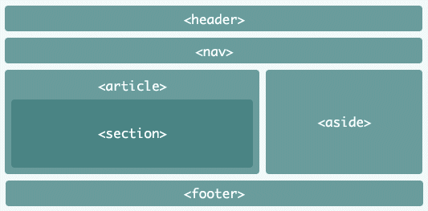
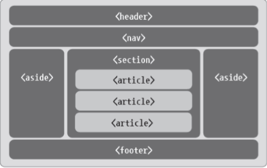

❤️‍🔥 TIL : Today I Learned

:::note 목적

시멘틱(semantic) 태그는 의미가 부여된 태그라는 뜻 입니다. 사용해야 하는 이유와 종류를 알아봅니다.

:::

<!--truncate-->

## 시맨틱 태그란?

- HTML 태그에서 가장 기본적으로 쓰이는 태그는 `
` 태그 입니다.
- HTML5 부터 등장 했습니다.

예를 들자면 `<header>`, `<main>`, `<footer>` 같은 태그가 있습니다. 이 태그를 보면 직관적으로 상단, 메인, 하단 태그라는 것을 알 수 있습니다.

## 시맨틱 태그를 사용해야 하는 이유

HTML 문서 레이아웃을 만들 때 시맨틱 태그를 사용하지 않고 `
` 태그를 활용하여도 무방합니다. 하지만 우리가 **시멘틱 태그를 사용해야 하는 이유**를 설명 드리겠습니다.

1. **가독성과 유지보수**가 쉬워집니다. 모든 태그가 `div`라고 한다면 한눈에 파악하기 어렵고 태그 영역이 햇갈립니다.
2. 웹 브라우저가 html만 보고 상단 `<header>`, 본문 `<main>`, 하단 `<footer>`, 사이드 `<aside>` 어느 **영역**인지 쉽게 알 수 있습니다.
3. **검색엔진**이 검색을 수행할 때 html내 **태그를 분석**합니다(SEO 최적화). `<article>` 태그는 재배포를 할 수 있는 콘텐츠, `<section>` 태그는 재배포를 금지하는 콘텐츠로 인식합니다.
4. 웹 접근성을 고려하여 시각 장애인들이 사이트를 이용할 때 사용되는 스크린 리더기 등을 통해 활용될 수 있습니다.

## 시멘틱 태그 종류

| 태그 | 설명 |
| --- | --- |
| `<header>` | 사이트의 머리부분에 사용 |
| `<main>` | 메인 콘텐츠를 나타내는데 사용 |
| `<section>` | 제목별로 나눌 수 있는 문서의 콘텐츠 영역을 구성하는 요소 |
| `<article>` | 개별 콘텐츠를 나타내는 요소 |
| `<aside>` | 좌우측의 사이드 영역 |
| `<footer>` | 사이트의 바닥부분, 주로 연락처나 제작자 정보등을 기술하는 부분 |
| `<hgroup>` | 제목과 부제목을 묶어서 나타내는 요소 |
| `<nav>` | 웹 페이지 메뉴를 만들 때 사용 |

:::tip 최종 정리

1. 시멘틱 태그를 사용하는 이유는 가독성이 좋아지고 유지 보수성이 좋아집니다.
2. 시멘틱 태그를 사용하면 웹 브라우저가 용도에 맞는 태그를 감지합니다.
3. 스크린 리더기를 통해 시각장애인 등을 위한 웹 접근성을 높일 수 있습니다.
4. SEO - 검색엔진에 검색이 되도록 최적화 할 수 있습니다.

:::

{/* 이 글은 Tistory(https://hyoloui.tistory.com/168)에서 옮겨 온 글입니다. 원문 작성일: 2023-04-06 */}
