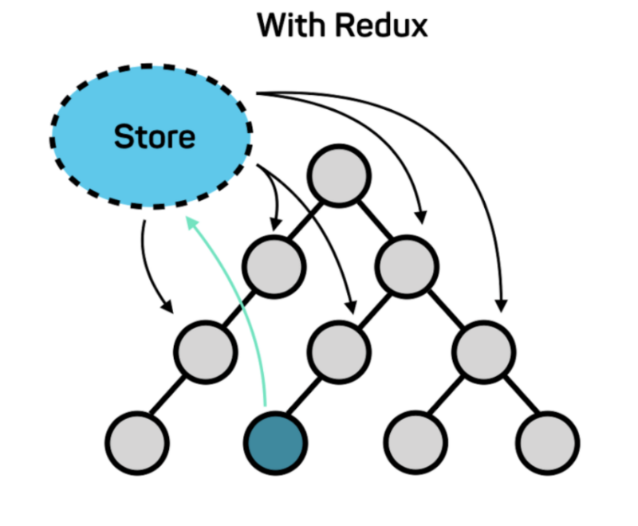
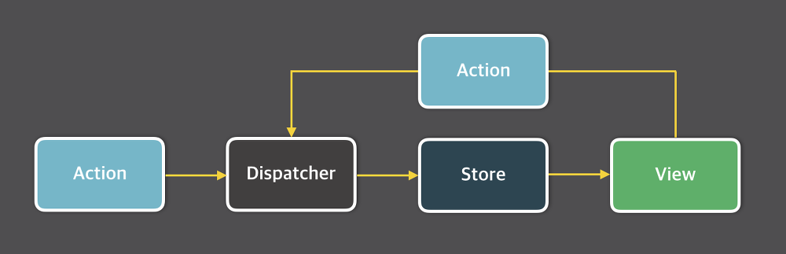
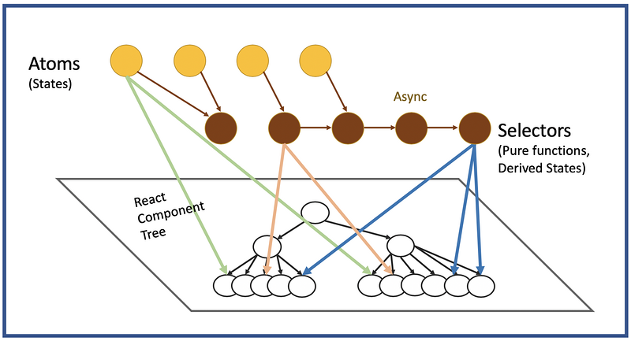

TIL : Today I Learned

<!--truncate-->

## Redux / Recoil

> Redux 와 Recoil을 비교하여 설명합니다.

### Redux 상태 관리 개념

#### 구조

**flux 패턴**을 사용하여, action이 발생하면 dispatcher에 의해 store에 변경된 사항이 저장되고, 그 상태에 의해 view가 변경되는, **데이터가 한 방향으로 흐르는 구조**를 갖는다.

1. Store: 애플리케이션의 상태를 보유하는 객체입니다. 모든 상태는 하나의 스토어에 저장됩니다.
2. Action: 상태를 변경하기 위해 발생시키는 이벤트입니다. 액션은 객체 형태로 정의되며, 액션에는 타입과 데이터가 포함됩니다.
3. Reducer: 액션을 처리하고 새로운 상태를 반환하는 순수 함수입니다. 액션의 타입에 따라 reducer가 처리되고, 새로운 상태를 반환합니다.
4. Dispatch: 액션을 발생시키는 함수입니다. 액션을 발생시키면, dispatch가 해당 액션을 reducer에게 전달합니다.

### Recoil 과의 비교

#### 구조

Recoil에서 제일 핵심이 되는 개념은 **atom** 이다. atom은 recoil에서 **상태(state)** 를 나타내며, **컴포넌트들이 구독할 수 있는 단위**이다. atom의 값을 읽는 컴포넌트들은 암묵적으로 atom을 **구독**한다. atom에 변화가 있으면 구독하는 모든 컴포넌트가 재렌더링된다.

Recoil은 최근에 Facebook에서 발표한 React 상태 관리 라이브러리입니다. Recoil의 주요 개념은 다음과 같습니다.

1. Atom: 애플리케이션의 상태를 정의하는 단위입니다. 각 Atom은 고유한 식별자와 초기값을 가지고 있습니다.
2. Selector: Atom에서 파생된 값을 계산하는 함수입니다. Selector는 다른 Selector와 Atom에 의존할 수 있습니다.

Redux와 Recoil은 상태 관리를 위한 라이브러리이지만, Redux는 액션과 리듀서를 사용하여 상태를 관리하고, Recoil은 Atom과 Selector를 사용하여 상태를 관리합니다. Redux는 액션을 처리하는 순수 함수를 작성해야 하기 때문에 상태 변경에 대한 제어가 엄격하고, Recoil은 Atom과 Selector를 사용하여 보다 유연하게 상태를 관리할 수 있습니다. 또한 Recoil은 React Hooks를 사용하여 간편하게 상태를 관리할 수 있기 때문에, 코드의 복잡성이 감소할 수 있습니다.

action → dispatch → reducer → view 의 흐름을 가지는 redux와 달리 atom → selector → view 의 data-flow를 가진다.

:::tip 최종 정리

1. React는 기존에 MVC 아키텍처 패턴을 가졌고, Redux가 Flux 패턴으로 어느 정도 해결했으나, Recoil이 React를 위한 상태관리 라이브러리로 출시되었다.
2. recoil 은 redux 와 비교했을 때 러닝커브가 낮고, 코드량도 recoil 이 훨씬 적다.
3. recoil 은 성능 이점을 얻을 수 있으나, 아직은 대규모 프로젝트에 적용하기에는 좋은 사례라든가 레퍼런스들이 부족하다

:::

{/* 이 글은 Tistory(https://hyoloui.tistory.com/169)에서 옮겨 온 글입니다. 원문 작성일: 2023-04-06 */}
