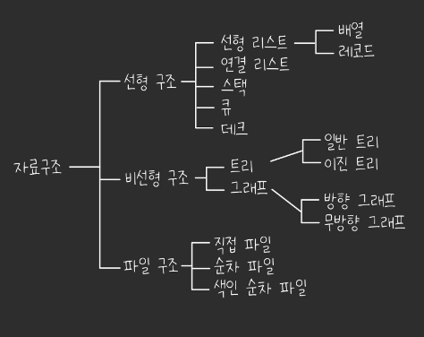

❤️‍🔥TIL : Today I Learned

## 선형 구조와 비선형 구조

> 선형 구조와 비선형 구조를 이해하고, 둘의 예시를 설명합니다.

<!--truncate-->

## 선형 구조와 비선형 구조

### 1. 선형 구조(Linear)

- 앞서 다뤄본 리스트와 연결리스트, 스택과 큐 는 선형구조로 자료를 구성하는 원소들을 하나씩 나열시킨 형태이다.
- 자료들간의 앞, 뒤 관계가 1:1의 관계로 배열과 리스트가 대표적이며 스택과 큐도 이에 해당된다.

[Tistory - 연결 리스트 || 링크드 리스트](https://hyoloui.tistory.com/164)

[Tistory - 스택, 큐](https://hyoloui.tistory.com/167)

### 2. 비선형 구조(NonLinear)

- 비선형 구조는 선형구조와 다르게, 하나의 자료 뒤에 여려개의 자료가 존재할 수 있는 형태이다.
- 자료들간의 앞, 뒤 관계가 1:n 또는 n:n의 관계를 나타낸다.
- 트리와 그래프가 대표적이며 계층적 구조를 나타내기에 적절하다.

**참조**

- [[Data Structure] 선형(Linear) & 비선형(NonLinear) 자료구조](https://jud00.tistory.com/entry/Data-Structure-%EC%84%A0%ED%98%95Linear-%EB%B9%84%EC%84%A0%ED%98%95NonLinear-%EC%9E%90%EB%A3%8C%EA%B5%AC%EC%A1%B0)

:::tip 최종 정리

1. 자료를 구성하는 원소를 하나씩 나타낸 자료구조를 **선형 구조**라 하며 대표적으로 리스트와 연결리스트, 스택과 큐가 있다.
2. 하나의 자료 뒤에 여러개의 자료가 존재할 수 있는 형태는 **비선형 구조**라 한다. 트리와 그래프가 대표적이며 계층적 구조에 적절하다.

:::

{/* 이 글은 Tistory(https://hyoloui.tistory.com/170)에서 옮겨 온 글입니다. 원문 작성일: 2023-04-06 */}
