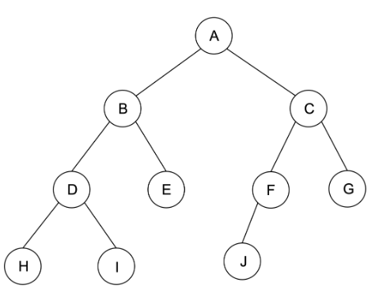
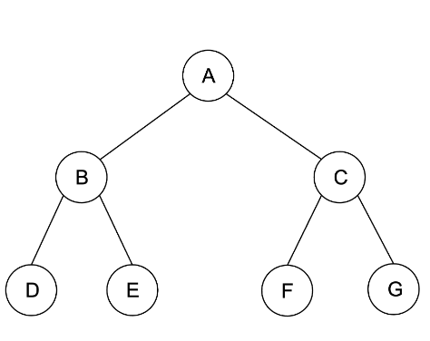
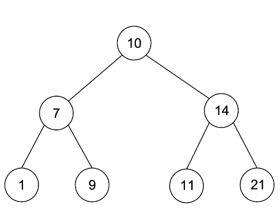
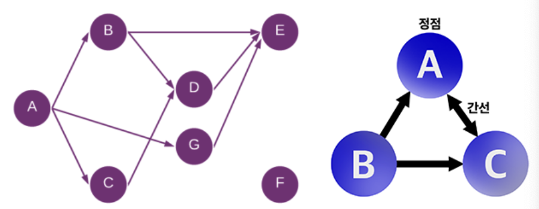
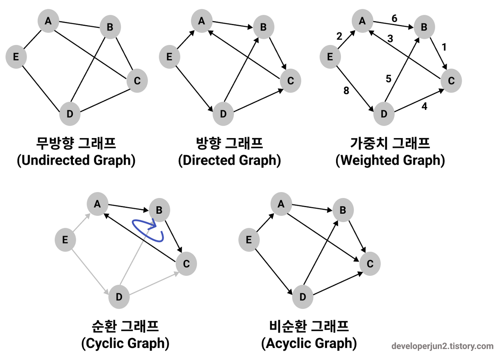
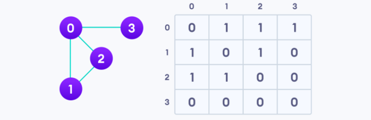
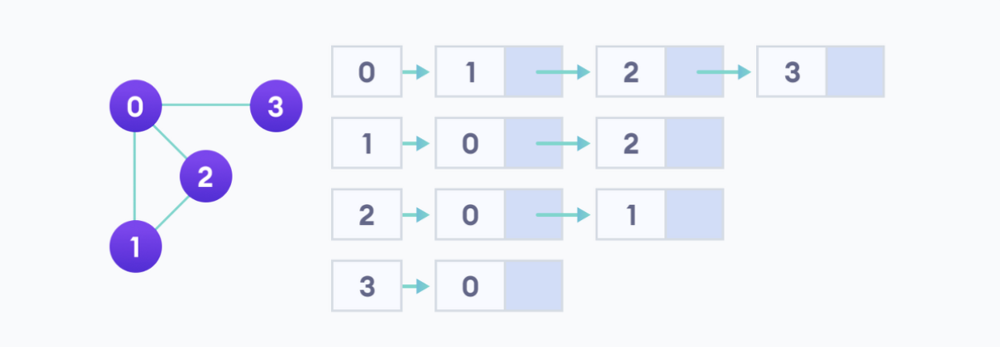
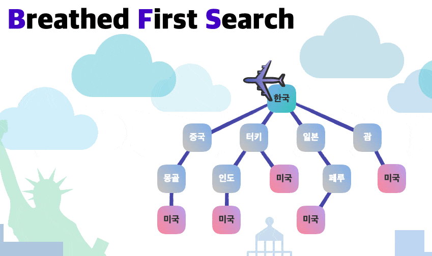
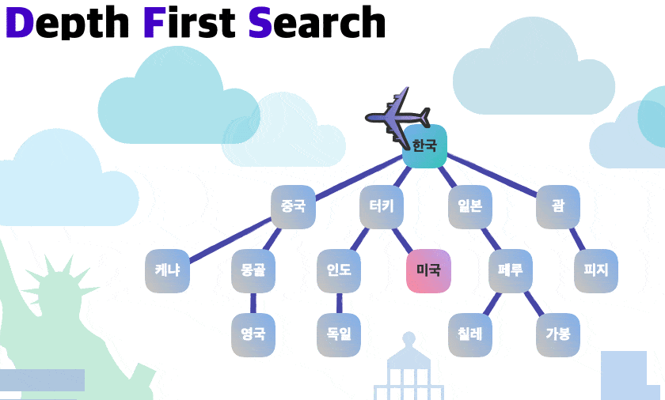

❤️‍🔥TIL : Today I Learned

## 트리, 그래프

> 비선형 구조인 트리와 그래프에 대해서 비교하고 설명합니다.

[Tistory - 선형 구조와 비선형 구조](https://hyoloui.tistory.com/170)

<!--truncate-->

## 트리 란?

### Tree 특징



- **나무를 거꾸로** 뒤집어 놓은 듯한 구조이다.
- 그래프의 여러 구조 중 무방향 그래프의 한 구조로 하나의 뿌리로부터 가지가 사방으로 뻗은 형태.
- **하나의 데이터 뒤에 여러 개의 데이터**가 존재할 수 있는 비선형 구조
- 아래로만 뻗어나가는 구조로 사이클이 없음.
- **루트(Root) 라는 하나의 최상단 꼭짓점 데이터**를 시작으로 여러 개의 데이터를 간선(edge)으로 연결한다.
- 각 데이터를 노드(Node)라고 하며, 두 개의 노드가 상하계층으로 연결되면 **부모/자식 관계**를 가짐
- 깊이와 높이, 레벨 등을 측정할 수 있음.

### 트리 관련 용어

- **루트**(Root): 부모가 없는 **최상위 노드**
- **노드**(Node) : 트리 구조를 이루는 모든 **개별** 데이터
- **부모** 노드(Parent node) : 두 노드가 상하 관계로 연결되어 있을 때 상대적으로 **루트와 가까운 노드**
- **자식** 노드(Child node) : 두 노드가 상하 관계로 연결되어 있을 때 상대적으로 **루트에서 먼 노드**
- **리프** 노드(leaf node) : 트리 구조의 끝지점이고, **자식 노드가 없는 노드**

### Tree 특징

1. 깊이 : **루트로부터** 하위 계층의 특정 노드까지의 깊이(depth) 표현 가능, 깊이 0에서 시작
2. 레벨 : **같은 깊이**를 가지고 있는 노드의 묶음, 같은 레벨에 나란히 있는 노드를 형제 노드(sibling node)라고 함
3. 높이 : **리프 노드를 기준으로 루트까지의 높이**, 트리 구조의 높이를 표현할 때에는 각 리프 노드의 높이를 0으로 함
4. 서브 트리 : 트리 구조의 root에서 뻗어나오는 큰 트리의 내부에 트리 구조를 갖춘 작은 트리

### 이진트리(Binary Tree)



- 트리를 구성하는 노드의 개수가 최대 2개의 서브 트리를 가진 트리
- 서브 트리 또한 모두 이진 트리이다. 즉 branch가 최대 2개인 노드로만 구성되는 트리 라는 뜻(max 2)

### 트리 순회

- 트리 순회란, 자료구조에 포함된 노드들을 특정한 방법으로 방문하는 방법이다.

1. 전위 순회(Pre-order traversal) : 노드, 왼쪽 자식, 오른쪽 자식 순서로 방문하는 순회 방법 ( A → B → C )
2. 중위 순회(In-order traversal) : 왼쪽 자식, 노드, 오른쪽 자식 순서로 방문하는 순회 방법 ( B → A → C )
3. 후위 순회(Post-order traversal) : 왼쪽 자식, 오른쪽 자식, 노드 순서로 방문하는 순회 방법 ( B → C → A )

### 이진 탐색 트리(Binary Search Tree, BST)



- 이진 탐색 트리는 위의 이진 트리에 조건이 더해진 것
- 모든 노드가 **`[ 왼쪽 자식 노드 > 부모 노드 > 오른쪽 자식 노드 ]`** 순서대로 값이 크다
- 부모 노드를 중심으로 작은 값은 왼쪽 자식 노드에 큰 값은 오른쪽 자식 노드에 존재해야 하므로, 이진 탐색 트리의 모든 노드의 데이터 값은 중복되는 값이 존재하면 안 된다. 즉, **데이터 값은 유일**해야 한다.

<!-- -->

- 부모 노드보다 왼쪽 자식의 노드가 작다.
- 부모 노드보다 오른쪽 자식의 노드가 크다.
- 같은 데이터 값을 가지는 노드는 없다.( 중복 데이터 X )

## 그래프 란?

### Graph 특징



- 컴퓨터 공학에서의 그래프 : 네트워크 망 형태
- 여러개 점들이 서로 복잡하게 연결되어 있는 구조
- 직접적인 관계가 있는 경우 두 점 사이를 이어주는 선 존재
- 인접 매트릭스 또는 인접 리스트로 표현 가능

### 그래프 용어

- 정점(vertex) : 노드(node)라고도 하며 데이터가 저장되는 기본 원소
- 간선(edge) : 정점 간의 관계 (정점을 이어주는 선)
- 인접 정점(adjacent vertex) : 하나의 정점에서 간선에 의해 직접 연결되어 있는 정점
- 가중치 그래프(weighted Graph) : 연결의 강도가 얼마나 되는지 적혀져 있는 그래프
- 비가중치 그래프(unweighted Graph) : 연결의 강도가 적혀져 있지 않는 그래프
- 무(방)향 그래프(undirected Graph) : 양방향 그래프(왕복차선), 단방향 그래프(directed) : 단방향인 간선으로 표현(일방통행)
- 진입차수(in-degree) / 진출차수(out-degree) : 정점에 진입(들어오는 간선)하고 진출(나가는 간선)하는 간선이 몇개인지를 나타냄
- 인접(adjacency) : 두 정점 간에 간선이 직접 이어져 있다면 이 두 정점은 인접한 정점
- 자기 루프(self loop) : 정점에서 진출하는 간선이 곧바로 자기 자신에게 진입하는 경우 자기 루프를 가졌다 라고 표현하며, 다른 정점을 거치지 않았다는 것이 특징
- 사이클(cycle) : 한 정점에서 출발하여 다시 해당 정점으로 돌아갈 수 있다면 사이클이 있다고 표현



### 그래프 표현 방식

- **인접 행렬** : A라는 정점과 B라는 정점이 이어져 있다면 1(true), 이어져 있지 않다면 0(false)으로 표시한 일종의 표. **가장 빠른 경로(shortest path)** 를 찾고자 할 때 주로 사용
- **인접 리스트** : 각 정점이 어떤 **정점과 인접한지**를 리스트의 형태로 표현. 정점마다 한개의 리스트를 가지고 있으며, 이 리스트는 자신과 인접한 다른 정점을 담고 있음

#### 인접 행렬(adjacency matrix)



- 세로(from), 가로(to)의 **2차원 배열**
- 각 vertex가 연결되어 있으면 `[from][to] = 1`
  - edge가 있음을 의미

edge 삭제 : `[from][to] = 0`

```js
// 인접 매트릭스
// 1. 인접 행렬은 2차원 배열로 그래프의 연결 관계를 표현하는 방식
// 2. 2차원 배열에 각 노드가 연결된 형태를 기록하는 방식

let matrix = [];
let max = 3; // 가장 큰 정점

// 2차원 배열 초기화 (for문)
for (let i = 0; i < max + 1; i++) {
  matrix.push(new Array(max + 1).fill(0));
}

// 2차원 배열 초기화 (map)
matrix = new Array(max + 1).fill(0).map((e) => new Array(max + 1).fill(0));

// 간선 추가
matrix[0][1] = 1; // 양방향 간선
matrix[1][0] = 1;

// 단방향 간선
matrix[2][0] = 1;

matrix[1][2] = 1;
matrix[2][1] = 1;

matrix[1][3] = 1;
matrix[3][1] = 1;
```

#### 인접 리스트(adjacency list)



- 그래프의 각 정점에 인접한 **정점을 연결 리스트로 표현**하는 방법
- 연결 리스트의 노드는 인접 정점 정보를 저장하는데, 그래프에는 이러한 각 인접 리스트에 대한 헤더 포인터를 갖는 배열로 갖고 있다.
  - 정점의 번호만 알고 있으면 각 정점의 연결 리스트에 쉽게 접근 가능

### 가중치 그래프와 비가중치 그래프

- 둘의 차이는 간선에 연결정도(거리)의 유무 이다.

```js
// 비가중치 그래프
let connectCity = {
  seoul: {
    busan: true,
    daejeon: true
  },
  daejeon: {
    seoul: true,
    busan: false
  },
  busan: {
    seoul: true,
    daejeon: false
  }
};

console.log(connectCity.seoul.daejeon); // true
console.log(connectCity.daejeon.busan); // false
```

### 그래프의 탐색 기법

- 그래프의 탐색 : 하나의 정점에서 시작하여 그래프의 모든 정점들을 한번씩 방문(탐색)하는 것을 목적으로 함
- 탐색 기법의 종류 : 너비 우선 검색인 BFS와, 깊이 우선 검색인 DFS 두 가지가 있다.

**BFS(Breadth-First Search) : 너비 우선 검색**

- 가장 가까운 정점부터 탐색
- 두 정점 사이의 최단 경로를 찾을 때 사용
- 최악의 경우에는 모든 경로를 다 살펴보아야 함
- Queue(with 반복문)와 활용도가 좋음



**DFS(Depth-First Search) : 깊이 우선 검색**

- 하나의 경로를 끝까지 탐색
- BFS 보다 탐색 시간은 오래걸리나, 모든 노드를 완전히 탐색 가능
- Stack(with 재귀함수)와 활용도가 좋음



**참조**

- [[자료구조] Stack, Queue, Graph, Tree](https://spiritfestival.tistory.com/113)

:::tip 최종 정리

1. 비선형 구조에는 트리와 그래프가 있다.
2. 트리는 나무를 거꾸로 뒤집어 놓은 데이터의 형태로 **하나의 데이터 뒤에 여러 개의 데이터**가 존재할 수 있는 비선형 구조이다.
3. 트리는 두 개의 노드가 상하계층으로 연결되면 **부모/자식 관계**를 가진다.
4. 이진 탐색 트리는 모든 노드가 **`[ 왼쪽 자식 노드 > 부모 노드 > 오른쪽 자식 노드 ]`** 순서대로 값이 크다.

<br />

- 그래프는 여러 개의 점들이 서로 복잡하게 연결되어 있는 구조 직접적인 관계가 있는 경우 두 점 사이를 이어주는 선 존재한다.
- 인접 행렬(매트릭스)은 2차원 배열 형태이며 또는 인접 리스트는 각 정점에 인접한 **정점을 연결 리스트로 표현**
- **그래프 탐색 기법은 최단 경로 검색에 유리한 너비 우선 검색(BFS)와 모든 노드를 완전탐색 하는 깊이 우선 탐색(DFS)가 있다**

:::

{/* 이 글은 Tistory(https://hyoloui.tistory.com/171)에서 옮겨 온 글입니다. 원문 작성일: 2023-04-06 */}
